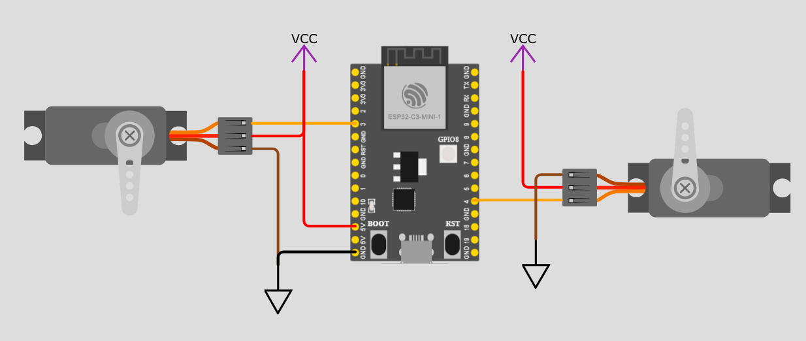

<div align="center">

# servo-wings ꒰ঌ(˶ˆᗜˆ˵)໒꒱

Wearable articulated wings driven by two servo motors and an **ESP32-C3**.  
The board creates its own Wi-Fi network and serves a lightweight web interface to control the flapping directly from your phone—no internet or external apps required.

[](LICENSE)
[](https://www.espressif.com/)
[](https://www.arduino.cc/)

[Español](README.md) · **English**

<br>

</div>

---

## About the project

This project started as an add-on for a Halloween costume. I wanted to give it a special, personal touch by doing what I love most: building and experimenting. The core idea is simple: an ESP32 sends pulses to two servos attached to the wings, creating a smooth flapping motion.

In practice, though, I ran into two main hurdles: making sure the battery would last all night, and being able to turn the mechanism off so I could be more comfortable moving through crowds. Taking advantage of the microcontroller's best-known feature, I set up a local Wi-Fi network that lets me turn the wings on and off from my phone whenever I want—solving both problems at once.

I don't consider this a final version; I see it as a working foundation that still has plenty of room to grow and be optimized :)

## Architecture & How It Works

The firmware runs on an **ESP32-C3 Super Mini** and coordinates the mirrored motion of two MG90S servos using a non-blocking loop, ensuring the web server responds immediately while the wings are in motion.

- **Sine-wave motion:** Instead of moving linearly and abruptly between two angles, the position is calculated using a sine wave around the resting point (`90°`), with an amplitude of `25°` to each side and a period of `1.8 seconds`. This smooths out acceleration and deceleration at the endpoints.
- **Idle detachment:** When turning off the flapping from the interface, the firmware calls `detach()` on both servos. By cutting the PWM signal, the motors stop straining to hold their position, reducing power draw and heat buildup.
- **State synchronization:** The web interface polls the board's status every 3 seconds, keeping the UI in sync even when multiple devices are connected simultaneously.

<details>
<summary><strong>HTTP Endpoints Reference</strong></summary>
<br>

| Route | Method | Description |
| :--- | :--- | :--- |
| `/` | `GET` | Serves the control web interface stored in Flash memory (`PROGMEM`). |
| `/on` | `GET` | Re-attaches the servos and starts the sine-wave flapping cycle. |
| `/off` | `GET` | Stops the flapping motion and releases the PWM signal (`detach`). |
| `/status` | `GET` | Returns the current state in JSON format (`{"flapping": true}`). |

</details>

---

## Bill of Materials

| Component | Quantity | Specifications |
| :--- | :---: | :--- |
| **ESP32-C3 Super Mini** | 1 | Main microcontroller with built-in Wi-Fi |
| **MG90S Servo Motor** | 2 | Micro servo with metal gears |
| **Electrolytic Capacitor** | 1 | 470 µF to 1000 µF (10V or 16V) for power filtering |
| **Power Bank** | 1 | 5V / 2A USB-C output |
| **Wing Frame** | 1 pair | Articulated frame and feathers |
| **Wiring** | — | Dupont jumper wires or flexible silicone wire |

## Wiring Diagram & Pinout

<div align="center">
  
</div>

<br>

| Signal / Component | ESP32-C3 Pin | Notes |
| :--- | :--- | :--- |
| **Left servo signal** | `GPIO 4` | Orange / yellow wire |
| **Right servo signal** | `GPIO 3` | Orange / yellow wire |
| **Servo power (VCC)** | `5V` | Red wire (drawn from the USB-C power bus) |
| **Common ground (GND)** | `GND` | Brown / black wire |
| **Electrolytic capacitor** | `5V` / `GND` | Connect in parallel close to the servos, observing polarity |

> [!IMPORTANT]
> Servo motors draw current spikes every time they start moving or change direction. The electrolytic capacitor absorbs these voltage drops to prevent the microcontroller from unexpectedly resetting.
> Do NOT power the servos directly from the microcontroller's regulated output!! They must be powered directly from the power source.

---

## Installation

1. Install [Arduino IDE](https://www.arduino.cc/en/software).
2. Go to **File > Preferences** and add the following URL to the *Additional Boards Manager URLs* field:
   ```text
   [https://espressif.github.io/arduino-esp32/package_esp32_index.json](https://espressif.github.io/arduino-esp32/package_esp32_index.json)
   ```
3. Open **Tools > Board > Boards Manager**, search for `esp32`, and install the official package by **Espressif Systems**.
4. Go to **Sketch > Include Library > Manage Libraries**, search for and install **`ESP32Servo`**.
5. Select **ESP32C3 Dev Module** under *Tools > Board > esp32*.
6. Open `firmware/servo-wings/servo-wings.ino`, select the corresponding port, and compile/upload the code.

## Usage

1. Connect the power bank to the USB-C port on the ESP32-C3.
2. On your phone, connect to the **`wifiname`** Wi-Fi network using the password **`password`**.
3. Open a web browser and go to **`http://192.168.4.1`**.
4. Use the on-screen buttons to start or stop the flapping motion.

> [!NOTE]
> Your mobile OS may warn you that the network has no internet access. Choose to keep the connection active; the local server runs completely standalone. For your security, change the `ssid` and `password` variables (minimum 8 characters) in the code before using the device in public spaces.

---

## Configurable Parameters

The main constants are defined at the top of `servo-wings.ino`:

| Parameter | Default Value | Function |
| :--- | :---: | :--- |
| `CENTER_LEFT` / `CENTER_RIGHT` | `90` | Resting angular position in degrees. Used to calibrate the physical symmetry of each wing. |
| `AMPLITUDE` | `25` | Maximum angular travel in degrees to each side from the center. |
| `PERIOD_MS` | `1800` | Duration in milliseconds of one full flapping cycle. |
| `WiFi.setTxPower(...)` | `WIFI_POWER_8_5dBm` | Caps Wi-Fi transmission power to ensure electrical stability on C3 Super Mini boards. |

---

## Repository Structure

```text
servowings/
├── firmware/
│   └── servo-wings/
│       └── servo-wings.ino   # Main source code
├── docs/
│   ├── demo.gif              # Flapping demonstration
│   └── pinout.png            # Wiring diagram
├── README.md                 # Spanish documentation
├── README.en.md              # English documentation
└── LICENSE                   # MIT License
```

## License

Distributed under the [MIT License](LICENSE).
