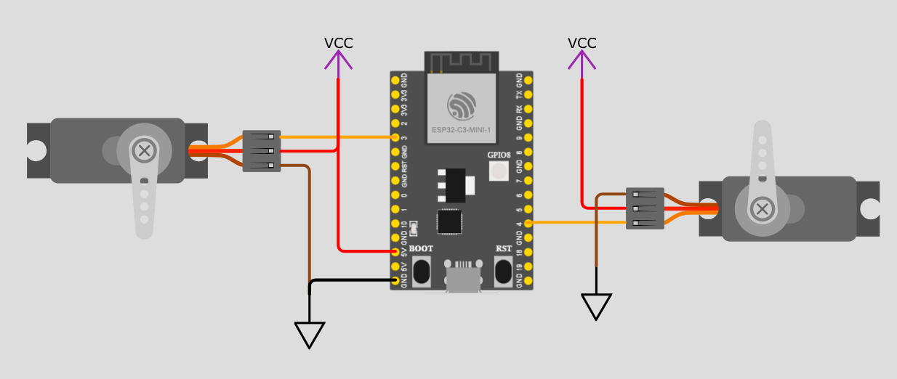

<div align="center">

# servo-wings ꒰ঌ(˶ˆᗜˆ˵)໒꒱

Alas articuladas vestibles impulsadas por dos servomotores y un **ESP32-C3**.  
La placa genera su propia red Wi-Fi e integra una interfaz web para controlar el aleteo desde el teléfono, sin internet ni aplicaciones externas.

[](LICENSE)
[](https://www.espressif.com/)
[](https://www.arduino.cc/)

**Español** · [English](README.en.md)

<br>


https://github.com/user-attachments/assets/3d379852-ef9c-48ba-8c15-12cc2b1d41b4


</div>

---

## Sobre el proyecto

Este proyecto nació como un complemento para un disfraz de Halloween. Quería darle un toque especial y personal haciendo lo que me gusta: crear y probar. La idea base es sencilla: un ESP32 le envía pulsos a dos servos conectados a las alas, permitiendo un aleteo suave.

Sin embargo, en la práctica me encontré con dos obstáculos: lograr que la batería durara toda la noche y poder apagar el mecanismo para estar más cómoda al moverme entre multitudes. Aprovechando la característica más conocida del microcontrolador, levanté una red Wi-Fi local que me permite encender y apagar las alas desde el celular a mi gusto, solucionando ambos problemas a la vez.

No considero que esta sea una versión definitiva; siento que es una base funcional que todavía tiene mucho margen para mejorar y optimizarse :)

## Arquitectura y funcionamiento

El firmware se ejecuta en un **ESP32-C3 Super Mini** y coordina el movimiento simétrico en espejo de dos servos MG90S mediante un bucle no bloqueante, garantizando que el servidor web responda al instante mientras las alas están en movimiento.

* **Movimiento senoidal:** En lugar de desplazarse de forma lineal y brusca entre dos ángulos, la posición se calcula mediante una onda senoidal alrededor del punto de reposo (`90°`), con una amplitud de `25°` por lado y un período de `1,8 segundos`. Esto suaviza la aceleración y el frenado en los extremos.
* **Desconexión en reposo:** Al apagar el aleteo desde la interfaz, el firmware ejecuta `detach()` sobre ambos servos. Al cortar la señal PWM, los motores dejan de hacer fuerza para sostener la posición, reduciendo el consumo energético y el calentamiento.
* **Sincronización de estado:** La interfaz web consulta el estado de la placa cada 3 segundos mediante polling, manteniendo sincronizada la vista aunque haya múltiples dispositivos conectados simultáneamente.

<details>
<summary><strong>Referencia de rutas HTTP</strong></summary>
<br>

| Ruta | Método | Descripción |
| :--- | :--- | :--- |
| `/` | `GET` | Sirve la interfaz web de control alojada en memoria Flash (`PROGMEM`). |
| `/on` | `GET` | Reconecta los servos e inicia el ciclo de movimiento senoidal. |
| `/off` | `GET` | Detiene el aleteo y libera la señal PWM (`detach`). |
| `/status` | `GET` | Devuelve el estado actual en formato JSON (`{"flapping": true}`). |

</details>

---

## Lista de materiales

| Componente | Cantidad | Especificaciones |
| :--- | :---: | :--- |
| **ESP32-C3 Super Mini** | 1 | Microcontrolador principal con Wi-Fi integrado |
| **Servomotor MG90S** | 2 | Micro servo con engranajes metálicos |
| **Capacitor electrolítico** | 1 | 470 µF a 1000 µF (10V o 16V) para filtrado de alimentación |
| **Power bank** | 1 | Salida USB-C de 5V / 2A |
| **Estructura de alas** | 1 par | Armazón articulado y plumas |
| **Cableado** | — | Cables Dupont o silicona flexible |

## Diagrama y conexiones

<div align="center">
  
</div>

<br>

| Señal / Componente | Pin en ESP32-C3 | Observaciones |
| :--- | :--- | :--- |
| **Señal servo izquierdo** | `GPIO 4` | Cable naranja / amarillo |
| **Señal servo derecho** | `GPIO 3` | Cable naranja / amarillo |
| **Alimentación servos (VCC)** | `5V` | Cable rojo (tomado desde el bus USB-C) |
| **Tierra común (GND)** | `GND` | Cable marrón / negro |
| **Capacitor electrolítico** | `5V` / `GND` | Conectar en paralelo cerca de los servos respetando polaridad |

> [!IMPORTANT]
> Los servomotores generan picos de corriente al iniciar cada cambio de dirección. El capacitor electrolítico absorbe estas caídas de tensión para evitar reinicios inesperados en el microcontrolador.
> NO alimentar a los servos desde el microcontrolador!! Deben alimentarse desde la fuente.

---

## Instalación

1. Instalar [Arduino IDE](https://www.arduino.cc/en/software).
2. Ir a **Archivo > Preferencias** y añadir la siguiente URL en el campo *Gestor de URLs adicionales de tarjetas*:
   ```text
   https://espressif.github.io/arduino-esp32/package_esp32_index.json
   ```
3. Abrir **Herramientas > Placa > Gestor de tarjetas**, buscar `esp32` e instalar el paquete oficial de **Espressif Systems**.
4. Ir a **Programa > Incluir librería > Administrar bibliotecas**, buscar e instalar **`ESP32Servo`**.
5. Seleccionar **ESP32C3 Dev Module** en *Herramientas > Placa > esp32*.
6. Abrir `firmware/servo-wings/servo-wings.ino`, seleccionar el puerto correspondiente y compilar/subir el código.

## Uso

1. Conectar la power bank al puerto USB-C del ESP32-C3.
2. Desde el teléfono, conectarse a la red Wi-Fi **`wifiname`** utilizando la contraseña **`password`**.
3. Abrir un navegador web e ingresar a **`[http://192.168.4.1]`**.
4. Utilizar los controles en pantalla para iniciar o detener el movimiento.

> [!NOTE]
> El sistema operativo móvil puede advertir que la red no dispone de conexión a internet. Selecciona mantener la conexión activa; el servidor local funciona de manera completamente autónoma. Por tu seguridad, modifica las variables `ssid` y `password` (mínimo 8 caracteres) en el código antes de utilizar el dispositivo en espacios públicos.

---

## Parámetros configurables

Las constantes principales se encuentran definidas al inicio del archivo `servo-wings.ino`:

| Parámetro | Valor por defecto | Función |
| :--- | :---: | :--- |
| `CENTER_LEFT` / `CENTER_RIGHT` | `90` | Posición angular de reposo en grados. Permite calibrar la simetría física de cada ala. |
| `AMPLITUDE` | `25` | Desplazamiento máximo en grados hacia cada lado respecto al centro. |
| `PERIOD_MS` | `1800` | Duración en milisegundos de un ciclo completo de aleteo. |
| `WiFi.setTxPower(...)` | `WIFI_POWER_8_5dBm` | Limita la potencia de transmisión Wi-Fi para garantizar estabilidad eléctrica en placas C3 Super Mini. |

---

## Estructura del repositorio

```text
servowings/
├── firmware/
│   └── servo-wings/
│       └── servo-wings.ino   # Código fuente principal
├── docs/
│   ├── demo.mov              # Demostración en movimiento
│   └── pinout.png            # Esquema de conexiones
├── README.md                 # Documentación en español
├── README.en.md              # Documentación en inglés
└── LICENSE                   # Licencia MIT
```

## Licencia

Distribuido bajo la [Licencia MIT](LICENSE).
